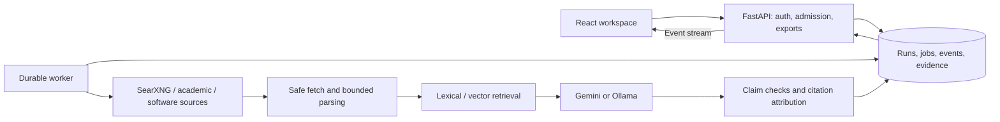

# ARES — Autonomous Research & Evidence System

ARES is a research workspace that discovers sources, retrieves relevant passages, writes cited answers, and records its evidence and activity. It is a staged pipeline with bounded concurrent discovery, not a collection of independently autonomous AI agents.

## Stack

- React 19 + TypeScript + Vite, served locally on port **5173**.
- FastAPI, SQLAlchemy and Alembic; Python 3.12+.
- PostgreSQL with pgvector and lexical search for production; SQLite for local/demo use.
- SearXNG web discovery, optional academic indexes and GitHub discovery.
- Gemini cloud synthesis or Ollama local synthesis (`qwen3:4b` by default).
- Optional embeddings, bounded PDF/media ingestion and source-linked visualizations.

## Architecture



See [architecture and invariants](docs/ARCHITECTURE.md), [evaluation methodology](docs/evaluation/METHODOLOGY.md), and [security reporting](SECURITY.md).

## Quick start

Requirements: Python 3.12+, Node 20.19+ (or a compatible recent Node 22), uv, pnpm, and Docker. The pnpm version is declared in `package.json`.

```bash
git clone https://github.com/aman-bhaskar-codes/ARES.git
cd ARES
uv sync --project backend --extra dev
corepack enable
pnpm install --frozen-lockfile
cp .env.example .env
docker compose -f infra/local/compose.yaml up -d
uv run --project backend alembic -c backend/alembic.ini upgrade head
```

The example defaults to **demo mode**, which uses recorded evidence and needs no model key. In separate terminals:

```bash
PYTHONPATH=backend/src uv run --project backend uvicorn ares.api.app:app --reload
PYTHONPATH=backend/src uv run --project backend python -m ares.worker.main
pnpm --filter @ares/web dev
```

Open **http://127.0.0.1:5173**. API health endpoints are `/health/live` and `/health/ready` on port 8000.

For live research, set `ARES_MODE=local_live` in `.env`. SearXNG must be available at `SEARXNG_URL`. For local writing:

```bash
ollama pull qwen3:4b
ollama serve
```

```dotenv
LOCAL_LLM_ENABLED=true
LOCAL_LLM_URL=http://127.0.0.1:11434
LOCAL_LLM_MODEL=qwen3:4b
```

For Gemini, configure `GEMINI_API_KEY` and explicit RPM/TPM/RPD limits for the account/model. The answer-model selector chooses the provider for each run. Availability means configured; it does not guarantee remote quota or model health. There is no automatic billable fallback. Web/academic discovery still sends queries to external services when using a local writer; this is not an entirely offline research mode.

## Production

Use `.env.production.example` and `infra/production/compose.yaml`. Provision OIDC, HTTPS at the reverse proxy, distinct API/worker database roles, immutable application images and a unique `SEARXNG_SECRET`. Run migrations before serving traffic. Production startup rejects disabled authentication, insecure cookies and invalid origins. API docs are disabled in production. Readiness derives the schema revision from the shipped migrations; leave `REQUIRED_SCHEMA_REVISION` unset unless intentionally overriding it.

```bash
PYTHONPATH=backend/src uv run --project backend python scripts/production_doctor.py --env-file .env.production
docker compose --env-file .env.production -f infra/production/compose.yaml config --quiet
```

## Verification

```bash
uv run --project backend ruff check backend/src backend/tests evals scripts
uv run --project backend pytest backend/tests -q
pnpm --filter @ares/web typecheck
pnpm --filter @ares/web test
pnpm --filter @ares/web build
PYTHONPATH=backend/src uv run --project backend python evals/run_suite.py --suite all --decision-provider deterministic --retrieval-mode lexical
```

PostgreSQL concurrency, RLS and pgvector tests require `ARES_TEST_POSTGRES_URL`. CI provisions PostgreSQL for these tests. Incremental typing debt is listed in [HARDENING_TYPE_DEBT.md](docs/HARDENING_TYPE_DEBT.md). Generated reports, screenshots, local databases and release archives are not source-controlled.

## Limitations

- Citation links establish provenance; they do not prove a claim is true or supported. Deterministic checks are heuristics. Optional semantic checks also need calibration.
- Search engines can throttle or challenge requests. Quotas, network errors and deadlines can yield partial reports or explicit failures.
- Small local models may give shorter answers or malformed structured output. Context and generation budgets bound the work.
- Public-web source quality varies. Retrieved content is untrusted and can contain prompt injection or conflicting information.
- The offline evaluation suite is development regression evidence, not a public-benchmark result or proof of production quality.
- Optional media, browser and embedding features need their own installed runtimes and provisioned models.
- This hardening pass is not an independent penetration test or production deployment certification.
