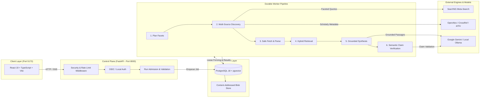

<div align="center">

# ARES
### Autonomous AI Research & Engineering System

[](Makefile)
[](backend/pyproject.toml)
[](apps/web/)
[](infra/local/compose.yaml)
[](LICENSE)

<p align="center">
  
</p>

**ARES is an autonomous, evidence-grounded research and engineering system that searches multi-source literature, retrieves passages with hybrid lexical/vector search, rigorously verifies claims, and produces cited, verifiable reports.**

[Key Features](#-key-features) • [Architecture](#-architecture) • [Quickstart](#-quickstart) • [Configuration](#-configuration--environment-variables) • [Execution Modes](#-execution-modes) • [Quality Gates](#-development--quality-gates) • [Security & Safety](#-security--trust-model)

---

</div>

## 🔬 System Overview

Unlike unconstrained chat wrappers or generative search tools that hallucinate references, ARES implements a **staged, durable execution pipeline with lease-fenced workers and claim-level verification**:

1. **Multi-Source Discovery**: Fans out queries across web search ([SearXNG](https://github.com/searxng/searxng)), academic repositories ([OpenAlex](https://openalex.org), [CrossRef](https://www.crossref.org), [arXiv](https://arxiv.org)), and software ecosystems ([GitHub API](https://docs.github.com/en/rest)).
2. **Safe Reading & Extraction**: Ingests web pages ([Trafilatura](https://trafilatura.readthedocs.io/)), PDFs ([pypdf](https://pypdf.readthedocs.io/)), and bounded media assets (local [Whisper](https://github.com/SYSTRAN/faster-whisper) audio transcription and OCR keyframe processing) through SSRF-guarded fetchers.
3. **Hybrid Retrieval**: Combines PostgreSQL full-text search (`tsvector` / BM25 ranking) with vector semantic search using `pgvector` HNSW indexes and local embeddings (`fastembed`).
4. **Grounded Synthesis**: LLM generation strictly bounded to admitted evidence passages via Google Gemini or private, self-hosted Ollama models (`qwen3:4b`).
5. **Semantic Claim Checking**: Automatically decomposes synthesized answers into atomic claims and cross-verifies each against extracted source passages to identify and filter unsupported claims.
6. **Live Replay & Canvas**: Streams execution milestones to a React 19 visual workspace over Server-Sent Events (SSE) with interactive citation inspection and graph exploration.

---

## 🏛 Architecture



---

## 🚀 Key Features

| Capability | Implementation & Location |
|---|---|
| **Durable Task Queue** | Advisory-locked monotonic lease manager preventing duplicate job execution during retries or crashes ([`jobs.py`](backend/src/ares/adapters/persistence/jobs.py)). |
| **Multi-Source Discovery** | Concurrent search coordinator querying SearXNG, OpenAlex, CrossRef, arXiv, and GitHub with source circuit breakers ([`search_coordinator.py`](backend/src/ares/application/search_coordinator.py)). |
| **Document Ingestion** | Robust text extraction for PDF, CSV, and HTML with size bounding and chunk attribution ([`documents.py`](backend/src/ares/application/documents.py)). |
| **Hybrid Vector & Text Search** | PostgreSQL `to_tsvector` full-text search combined with `pgvector` HNSW cosine similarity search ([`retrieval.py`](backend/src/ares/adapters/persistence/retrieval.py)). |
| **Multimodal Extraction** | Background workers for Whisper speech-to-text (`small-multilingual`), OCR keyframe processing, and video frame extraction ([`media.py`](backend/src/ares/adapters/multimodal/media.py)). |
| **Grounded LLM Synthesis** | Context-bounded synthesis with Gemini API or private local Ollama (`qwen3:4b`) instances ([`gemini_writer.py`](backend/src/ares/adapters/gemini_writer.py), [`ollama_synthesis.py`](backend/src/ares/adapters/ollama_synthesis.py)). |
| **Semantic Claim Verifier** | Post-generation factual assertion validator verifying claims against retrieved evidence passages ([`gemini_semantic.py`](backend/src/ares/adapters/gemini_semantic.py)). |
| **Visual Workspace** | React 19 interface with reconnectable SSE streams, citation graph explorer, and export renderers ([`apps/web/`](apps/web/)). |
| **Multi-Tenant Security** | PostgreSQL Row-Level Security (RLS), OIDC auth, token-bucket rate limiter, and RFC 6266 filename sanitization ([`security_headers.py`](backend/src/ares/api/security_headers.py), [`rate_limit.py`](backend/src/ares/api/rate_limit.py)). |

---

## ⚡ Quickstart

### Prerequisites

- **Python**: `>=3.12, <3.16` (Python 3.12 or 3.13)
- **uv**: Python package manager (`curl -LsSf https://astral.sh/uv/install.sh | sh`)
- **Node.js**: `>=20` (Node 24 LTS recommended) with `corepack` enabled
- **Docker**: For PostgreSQL + pgvector and SearXNG containers

### Option A: Local Development Stack (Recommended)

1. **Clone Repository**:
   ```bash
   git clone https://github.com/aman-bhaskar-codes/ARES.git
   cd ARES
   ```

2. **Configure Environment**:
   ```bash
   cp .env.example .env
   ```
   *(By default, ARES boots in keyless **demo mode**, which uses recorded evidence and requires zero API keys).*

3. **Install Dependencies**:
   ```bash
   uv sync --project backend --extra dev
   export COREPACK_ENABLE_DOWNLOAD_PROMPT=0
   corepack enable
   pnpm install --frozen-lockfile
   ```

4. **Start Infrastructure & Apply Migrations**:
   ```bash
   make dev
   ```
   *(This starts PostgreSQL 18 with pgvector and SearXNG in Docker, then applies all Alembic database migrations).*

5. **Start Application Services**:
   In separate terminal panes or windows:
   ```bash
   # Terminal 1: FastAPI Control Plane (http://127.0.0.1:8000)
   make api

   # Terminal 2: Durable Background Worker
   make worker

   # Terminal 3: React 19 Web Interface (http://127.0.0.1:5173)
   make web
   ```

6. **Open Web Interface**:
   Visit **[http://127.0.0.1:5173](http://127.0.0.1:5173)** in your browser. API health and readiness endpoints are available at `http://127.0.0.1:8000/health/live` and `http://127.0.0.1:8000/health/ready`.

---

### Option B: Live Research Mode

To enable live web and academic research:

1. In `.env`, set:
   ```dotenv
   ARES_MODE=local_live
   ```

2. **Choice A — Gemini Cloud Synthesis**:
   Configure your Gemini API key and explicit rate limits:
   ```dotenv
   GEMINI_API_KEY=your-api-key-here
   GEMINI_MODEL=gemini-3.5-flash-lite
   GEMINI_RPM=15
   GEMINI_TPM=1000000
   GEMINI_RPD=1500
   ```

3. **Choice B — 100% Local Private LLM (Ollama)**:
   Run a local model without sending research queries to cloud LLMs:
   ```bash
   ollama pull qwen3:4b
   ollama serve
   ```
   In `.env`:
   ```dotenv
   LOCAL_LLM_ENABLED=true
   LOCAL_LLM_URL=http://127.0.0.1:11434
   LOCAL_LLM_MODEL=qwen3:4b
   ```

---

## ⚙ Configuration & Environment Variables

| Variable | Description | Default | Required in Production |
|---|---|---|:---:|
| `ARES_MODE` | System execution profile (`demo`, `local_live`) | `demo` | No |
| `DEPLOYMENT_ENVIRONMENT` | Target environment (`local`, `production`) | `local` | **Yes** (`production`) |
| `AUTH_MODE` | Authentication provider (`disabled`, `oidc`) | `disabled` | **Yes** (`oidc`) |
| `STRICT_FREE_MODE` | Prohibits silent paid API fallbacks | `true` | **Yes** (`true`) |
| `ALLOW_BILLABLE_PROVIDERS` | Explicit override allowing billable LLM providers | `false` | No |
| `DATABASE_URL` | Primary PostgreSQL database connection URL | SQLite (local) | **Yes** (PostgreSQL) |
| `WORKER_DATABASE_URL` | Dedicated connection URL for background worker | `""` | **Yes** (distinct role) |
| `SEARXNG_URL` | SearXNG meta-search instance endpoint | `http://127.0.0.1:8080` | **Yes** |
| `SEARXNG_SECRET` | Secret key for SearXNG instance | `""` | **Yes** |
| `PUBLIC_BASE_URL` | Fully-qualified public URL of ARES API | `http://127.0.0.1:8000` | **Yes** (HTTPS) |
| `FRONTEND_ORIGIN` | Allowed web origin for CORS and CSRF checks | `http://127.0.0.1:5173` | **Yes** (HTTPS) |
| `SESSION_COOKIE_SECURE` | Enforces `Secure` flag on session cookies | `false` | **Yes** (`true`) |
| `GEMINI_API_KEY` | Google Gemini API key | `""` | If Gemini selected |
| `LOCAL_LLM_ENABLED` | Enables local Ollama synthesis | `false` | No |
| `RATE_LIMIT_ENABLED` | Enables per-client token-bucket rate limiting | `null` (auto) | Yes (auto-active) |

---

## 🔄 Execution Modes

```
                   ┌──────────────────────────────────────────────┐
                   │               Execution Modes                │
                   └──────────────────────┬───────────────────────┘
                                          │
            ┌─────────────────────────────┼─────────────────────────────┐
            ▼                             ▼                             ▼
   ┌─────────────────┐           ┌─────────────────┐           ┌─────────────────┐
   │    demo mode    │           │ local_live mode │           │ production mode │
   ├─────────────────┤           ├─────────────────┤           ├─────────────────┤
   │ • Zero API keys │           │ • Live web &    │           │ • Mandatory     │
   │ • Recorded data │           │   academic APIs │           │   OIDC auth     │
   │ • Fast test run │           │ • Gemini or     │           │ • PostgreSQL    │
   │ • Local UI test │           │   Ollama Qwen   │           │   with RLS      │
   │ • Loopback-only │           │ • Rate-limited  │           │ • Dual DB roles │
   └─────────────────┘           └─────────────────┘           └─────────────────┘
```

1. **`demo`**: Offline recorded evidence fixtures. Perfect for evaluating UI capabilities, running offline regression suites, and local onboarding without external credentials.
2. **`local_live`**: Real-time discovery using local SearXNG and academic APIs. Answers synthesized via Gemini or local Ollama. Bound to loopback interface (`127.0.0.1`) to prevent accidental network exposure.
3. **`production`**: Enforces strict security invariants: OIDC identity authentication, HTTPS origins, distinct database roles for API and worker processes, Row-Level Security, and private S3/blob storage.

---

## 🛡 Security & Trust Model

ARES is engineered with defense-in-depth principles:

- **Zero Billable Fallback**: `STRICT_FREE_MODE=true` is enforced at the configuration level. The system will fail with an explicit diagnostic rather than secretly falling back to paid, metered APIs.
- **SSRF & DNS Rebinding Resistance**: All outbound source fetchers validate resolved IP addresses against private and cloud-metadata IP ranges, pinning targets to prevent DNS rebinding attacks.
- **Strict Content-Disposition (RFC 6266)**: File download endpoints sanitize filenames using both ASCII fallbacks and RFC 5987 percent-encoded UTF-8 strings to prevent CRLF injection and path traversal.
- **Loopback Enforcement**: When `AUTH_MODE=disabled`, the control plane strictly refuses to bind to non-loopback network interfaces unless `ALLOW_INSECURE_REMOTE_DISABLED_AUTH=true` is explicitly provided.
- **Row-Level Security (RLS)**: PostgreSQL enforces workspace-level tenant isolation natively in SQL queries via transaction variables (`app.current_tenant`).
- **Comprehensive Headers**: Built-in middleware enforces `X-Content-Type-Options: nosniff`, `X-Frame-Options: DENY`, `Referrer-Policy: strict-origin-when-cross-origin`, and strict Content Security Policy (CSP).

---

## 🛠 Development & Quality Gates

Run `make help` for a complete list of CLI commands:

```bash
make help
```

### The 10 Quality Gates (`make check`)

ARES maintains 10 continuous quality gates that must pass prior to every release:

```bash
make check
```

| Gate | Command | Description |
|---|---|---|
| **1. Doctor** | `make doctor` | Validates Python, Node, uv, and environment variable configuration |
| **2. Lock Check** | `make lock-check` | Verifies `backend/uv.lock` matches `pyproject.toml` |
| **3. Linting** | `make lint` | Enforces code formatting, import sorting, and Ruff security checks |
| **4. Typecheck** | `make typecheck` | Strict Mypy type validation on core domain models and ports |
| **5. Secret Scan** | `make security-scan` | Deterministic workspace scanner ensuring no credentials or keys are exposed |
| **6. Test Suite** | `make test` | Executes 175+ backend unit tests and integration test suites |
| **7. Offline Eval** | `make eval-regression` | Evaluates research routing and retrieval against labeled golden datasets |
| **8. Compilation** | `make test-compile` | Compiles all Python source files to catch bytecode syntax anomalies |
| **9. Migrations** | `make verify-migrations` | Verifies Alembic migrations and PostgreSQL schema compatibility |
| **10. Release Check**| `make verify-m11-release`| Validates end-to-end package integrity, bundle assets, and OpenAPI schema |

---

## 📄 License

ARES is licensed under the [Apache License, Version 2.0](LICENSE).
See `LICENSE` for details.
