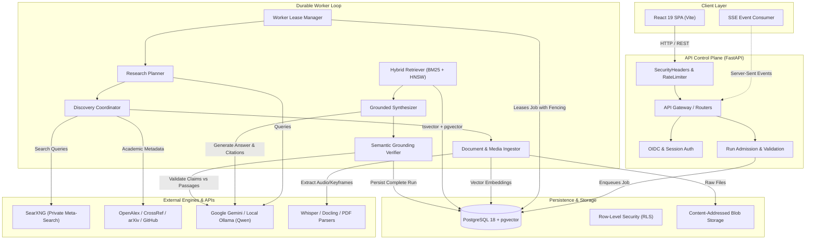

# ARES System Architecture

ARES (Autonomous AI Research & Engineering System) is structured around a staged, durable execution model designed for high-assurance, grounded scientific research and engineering synthesis.

---

## 1. High-Level Component Topology

---

## 2. Core Subsystems

### A. API Control Plane (`ares.api`)
- **Authentication & Multi-Tenancy**: Supports OIDC in production and local-loopback authentication in development. Session cookies are protected with double-submit CSRF tokens.
- **Security Middleware**: Centralizes `X-Content-Type-Options: nosniff`, `X-Frame-Options: DENY`, strict CSP, and per-client token-bucket rate limiting across mutation and run admission endpoints.
- **Run Admission**: Enforces concurrency caps per workspace and validates requested modalities before enqueuing durable jobs into the relational store.

### B. Durable Worker Engine (`ares.worker`)
- **Lease Fencing**: Workers poll for pending jobs using advisory locks and monotonic leases, guaranteeing at-most-once active execution per run attempt.
- **Execution Pipeline**:
  1. **Planning**: Deconstructs research queries into faceted search intents.
  2. **Discovery**: Concurrent fan-out across SearXNG, OpenAlex, CrossRef, arXiv, and GitHub API with individual source circuit breakers.
  3. **Reading & Parsing**: Ingests web pages (Trafilatura), PDFs (`pypdf`), and optional audio/video media (bounded Whisper and keyframe OCR).
  4. **Hybrid Retrieval**: PostgreSQL full-text search (`to_tsvector`) combined with vector similarity search via `pgvector` HNSW indexes.
  5. **Grounded Synthesis**: LLM generation (Gemini or local Ollama) strictly bounded to admitted evidence passages.
  6. **Semantic Verification**: Post-synthesis assertion checking to detect and filter unsupported claims.

### C. Persistence & Multi-Tenant Isolation (`ares.adapters.persistence`)
- **PostgreSQL with RLS**: Tenant boundaries are enforced natively at the database engine level via Row-Level Security session variables (`app.current_tenant`).
- **Content-Addressed Blobs**: Ingested artifacts are hashed (SHA-256) and stored in path-confined directories or S3-compatible buckets.
- **Event Journal**: Replayable append-only log of execution milestones streamed to clients via Server-Sent Events (SSE).

---

## 3. Key Invariants

1. **Evidence-Grounded Synthesis**: Citations resolve only to admitted, immutable evidence records for that specific run; hallucinated sources are rejected.
2. **Explicit Cost & Provider Boundaries**: Paid cloud services and external LLM calls require explicit configuration; silent fallbacks to billable APIs are strictly prohibited (`STRICT_FREE_MODE`).
3. **Data Isolation**: Workspaces cannot access or query data belonging to other tenants.
4. **Idempotency & Replay**: Re-running or re-reading an event stream produces identical event milestones without duplicate side effects.
5. **SSRF Resistance**: External web fetching enforces strict host allowlists, DNS rebinding mitigations, and private IP rejection.
